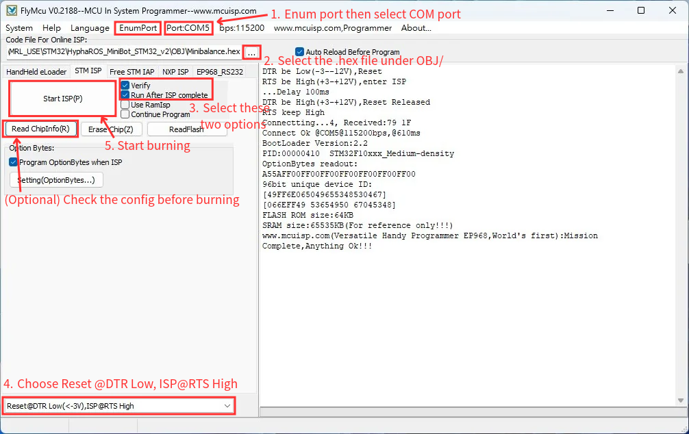

# hypharos_minibot_STM32 (v1)
Original firmware for the STM32F103 MCU on the [HyphaROS MiniBot](https://github.com/Hypha-ROS/hypharos_minibot).

> **Note:** This branch keeps the original version for reference only.
> The original hardware modules are discontinued; for the current hardware, see the `v2` (`main`) branch.

## Versions
| Branch | Description |
|---|---|
| `v1` | Original HyphaROS MiniBot firmware (Keil MDK 4 project) |
| `v2` (`main`) | Ported to the new WHEELTEC hardware by NCU MRL (Keil MDK 5 project) |

## Hardware
- MCU board: STM32F103C8T6 (MiniBalance board from 平衡小车之家)
- Peripherals used by the firmware: OLED display, two wheel encoders (TIM2 / TIM3), dual motor PWM, battery voltage ADC
- Bluetooth module on USART2

## Build
Open `HyphaROS_MiniBot_STM32/USER/Minibalance.uvproj` with Keil MDK.
This is an MDK 4 project; MDK 5 may ask you to install **MDK v4 Legacy Support** or to migrate the project.
The output is `HyphaROS_MiniBot_STM32/OBJ/Minibalance.hex`.

## Flash
A prebuilt `HyphaROS_MiniBot_STM32/OBJ/Minibalance.hex` (built by the original author in 2018) is included.
Flash it over USB-serial with FlyMcu
(unzip `FlyMcu.zip` in this repo, or download it from the [official site](http://www.mcuisp.com/)):

1. Click **EnumPort** and select the COM port (bps: `115200`).
2. Select `HyphaROS_MiniBot_STM32/OBJ/Minibalance.hex` as the code file.
3. Check **Verify** and **Run After ISP complete**.
4. Set the bottom option to **Reset@DTR Low(<-3V), ISP@RTS High**.
5. Click **Start ISP(P)**.

## Credits
Firmware from [HyphaROS MiniBot](https://github.com/Hypha-ROS/hypharos_minibot) by HaoChih Lin,
based on the MiniBalance sample code by 平衡小车之家.
